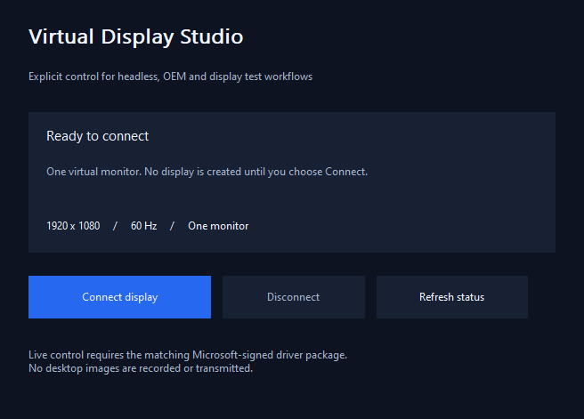

# Virtual Display Studio

**An explicit virtual monitor controller and C++ SDK for Windows OEM, headless and display test workflows.**

Connect one 1920 x 1080 virtual monitor at 60 Hz, inspect its state and disconnect it from a small native application. A console controller and single-file UI/console installer sources are included.



**Status: application/SDK preview.** The matching Windows 10/11 driver package 0.1.1.0 is awaiting Microsoft signing and further runtime qualification. The release ZIP contains the application, SDK, console control and installer source; it does not include an unsigned driver or a setup executable. The application opens without changing your display configuration. No monitor is created at installation, Windows startup or normal application startup.

## What it does

- Explicit Connect / Disconnect for one SDR virtual monitor, 1920 x 1080 at 60 Hz.
- Administrator-only driver control, with the connection owned by the application's open handle.
- Automatic monitor departure when the owning application closes or its process terminates.
- A fixed, versioned C++ interface with driver state and actionable Windows errors.
- No desktop recording, screenshot storage, remote-control service or network communication.

The display implementation uses Microsoft's **UMDF indirect display driver model (IddCx)**. The private driver is a DLL hosted by Windows' driver framework alongside the system IndirectKmd component. It is a display driver, rather than an input filter. The application's source is public; driver source is private.

## Install and use

The following steps apply **after a Microsoft-signed driver release is available**:

1. Download the Windows x64 package from [Releases](https://github.com/titanfyre/Virtual-Display-Studio/releases).
2. Close other instances and run `VirtualDisplaySetup.exe` as administrator. Choose **Install / reinstall**.
3. Restart Windows only if setup requests it. Setup never restarts automatically.
4. Open `VirtualDisplayStudio.exe` and choose **Connect display**. Accept administrator elevation when requested.
5. Use Windows **Settings > System > Display** to arrange the virtual monitor. Choose **Disconnect** or close its owning application to remove it.

The application keeps its driver handle open for the lifetime of the connection. The console tool behaves the same way:

```console
DisplayControl.exe status
DisplayControl.exe connect
```

Run the console as administrator. `connect` waits for Enter, then closes the handle and disconnects. A second application can query the monitor but cannot steal an existing connection. The display starts disconnected after suspend or a device restart; choose Connect again.

Uninstall with the UI or `VirtualDisplaySetupConsole.exe /uninstall`. Enterprise setup supports `/install` and `/uninstall`; exit `3010` means a restart is required. The installer verifies the exact package identity, a trusted Microsoft hardware-publisher catalog and INF/DLL catalog membership before it attempts installation. No test-signing or Secure Boot setting is changed.

## Build the public application

Requires Windows x64, Visual Studio 2022 with C++ desktop tools, CMake 3.20+ and the Windows SDK.

```powershell
.\Build.ps1
.\Build.ps1 -Asan
```

Executables are written to `obj/Build/Release`. Without an opaque signed driver package, installer builds contain no driver payload and cannot install anything.

For authorized distribution of an already-signed package:

```powershell
cmake -S . -B obj/Package -G "Visual Studio 17 2022" -A x64 -DDRIVER_PACKAGE_DIRECTORY="C:/Signed/TitanVirtualDisplay"
cmake --build obj/Package --config Release
```

The directory must contain the exact matching `TitanVirtualDisplay.inf`, `.cat` and `.dll`. They are embedded into each setup executable; no external payload files are required at installation. The signing/package checks still run at installation.

## Minimal C++ integration

```cpp
#include "Display.h"

VirtualDisplay display; // Keep this alive while the monitor is needed.
DisplayProtocol::State state;
DWORD error = display.Execute(DisplayProtocol::Action::Connect, state);
if (error) {
    auto message = VirtualDisplay::Error(error);
}
// Destroying display closes the handle and disconnects its monitor.
```

Compile `App/Display.cpp` and link `setupapi.lib`. Use `Action::Query` for state and `Action::Disconnect` for an explicit departure. The fixed mode is returned in `state.width`, `height` and `hz`. `state.owned` indicates whether this handle owns the monitor. `adapter_status` preserves the driver's initialization NTSTATUS for diagnostics.

## Validation and limitations

The x64 application and private driver compile with warnings as errors. Offline protocol/recovery checks, installer package identity/trust checks, tampered INF/DLL rejection, AddressSanitizer protocol checks, InfVerif and Inf2Cat checks pass. The corrected driver candidate passed 91 checks and 32 connect/disconnect cycles on Windows 10 build 19045 in normal mode and with UMDF Verifier enabled, including administrator access checks, ownership and abrupt process cleanup. These VM tests used a temporary lab signature, not a Microsoft signature for the new package. Final signed-package installation, Windows 11 and physical GPU rendering/suspend/resume qualification remain pending. See [validation details](docs/VALIDATION.md).

This preview supports one 1080p60 SDR monitor. It has no HDR, variable refresh rate, streaming, audio transport or secure trial/licensing mechanism. There is no guarantee of a particular GPU, game, remote-desktop or capture application's behavior. Existing free virtual display drivers are available; this project focuses on an explicit integration interface and operator-controlled lifetime.

## OEM integration and support

For production integration, deployment assistance or a scoped development quote, contact **`titancsa` on Discord**. Describe your Windows versions, GPU environment, application and deployment count. Custom modes or commercial features are not available until explicitly implemented and validated for the agreed scope.

## License and responsible use

Public application, control SDK and installer source: [MIT](LICENSE). Driver binaries have separate distribution terms and upstream Microsoft MS-PL notices. Microsoft signing is an integrity/distribution requirement; it does not constitute Microsoft endorsement or WHQL certification.

Use only on systems you own or administer with permission and comply with applicable laws and third-party terms. This project is intended for legitimate display, accessibility, OEM integration and testing. To the extent permitted by law, the author is not responsible for misuse, unlawful activity or resulting damage; the software is provided without warranty. This notice does not exclude rights or liability that law makes non-excludable.
